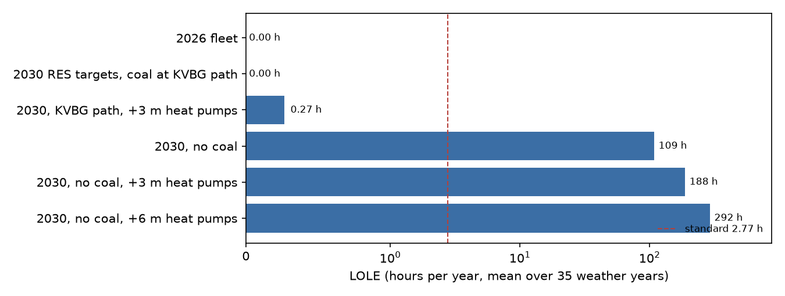
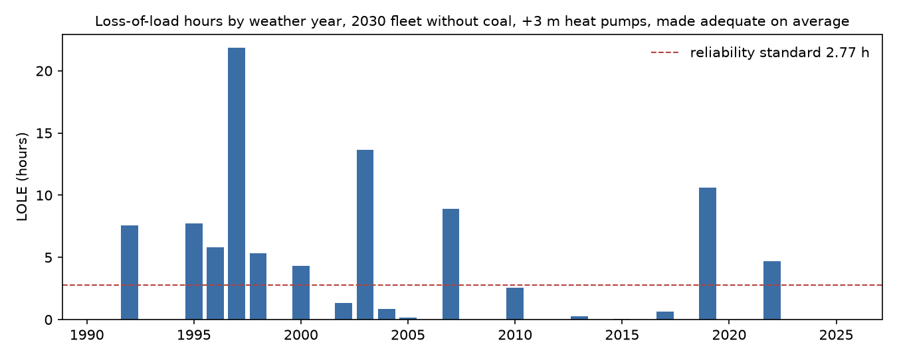
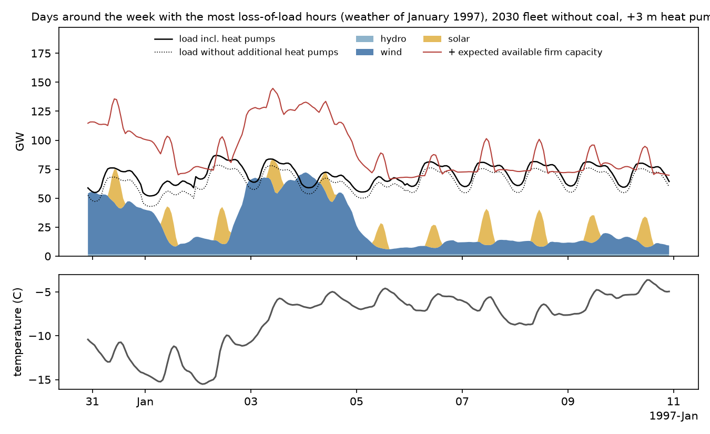
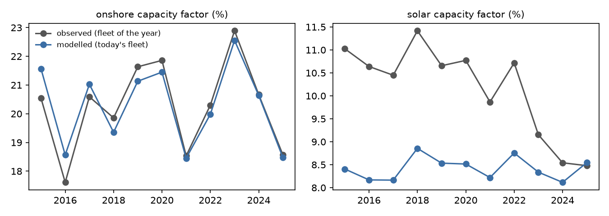

# Will the lights stay on? Resource adequacy of the German power system across 35 weather years, and in a warmer climate (v0.2)

[](https://github.com/michaelserikov/de-power-adequacy/actions/workflows/tests.yml)

How often would German electricity demand exceed the available supply if the weather of any year since 1991 came back with today's or a 2030 power system, how much firm capacity does the 2030 system need to meet the German reliability standard and which weather causes the shortfalls? This project runs 35 weather years of ERA5 reanalysis (1991-2025) through weather-to-power and demand models fitted to observed German data, adds the electricity demand of additional heat pumps, and computes the loss-of-load expectation (LOLE) and expected energy not served (EENS) with a capacity outage probability table of the dispatchable fleet. It builds on the weather-to-power models of [de-weather-to-power](https://github.com/michaelserikov/de-weather-to-power).

This is a single-country study with illustrative assumptions for plant outages and storage, not an official adequacy assessment. Germany is treated as an island; imports enter only as a sensitivity. See [Limitations](#limitations).

**Main findings**
- **Today's fleet is adequate in every weather year.** With the 2026 fleet (Energy-Charts) and no imports, no weather year since 1991 produces a loss-of-load hour: peak net demand (load minus wind, solar, hydro and storage) is 61 GW against 75 GW of expected available dispatchable capacity.
- **The 2030 renewable targets do not replace firm capacity.** With the EEG 2023 and WindSeeG targets for 2030 (115 GW onshore, 30 GW offshore, 215 GW solar) and coal on the legal path of the coal exit law (KVBG section 4: 9 GW lignite, 8 GW hard coal), LOLE stays at 0, and at 0.27 hours per year with 3 million additional heat pumps. Without any coal, the same system has a LOLE of 109 hours per year (188 with 3 million and 293 with 6 million additional heat pumps), far above the German reliability standard of 2.77 hours. Meeting the standard then needs 9.6, 14.2 and 19.5 GW of new firm capacity.
- **Each additional million heat pumps adds 1.5 to 1.8 GW to the firm capacity need**, because their demand peaks when it is coldest, which is also when their efficiency is lowest.
- **Shortfalls come from cold, windless winter evenings.** 99.7% of the loss-of-load hours fall in December to February and half of them between 16:00 and 20:00 local time. In those hours the national temperature averages -4.8 C (winter mean 2.0 C) and wind farms run at 4.8% of capacity (winter mean 30.7%).
- **Capacity credit is low for wind and solar and moderate for storage.** In the 2030 system without coal, 10 GW more onshore wind replace 0.55 GW of firm capacity (ELCC 5.5%), offshore wind 4.5% and solar 0.5%; 10 GW of four-hour batteries replace 3.75 GW (37.5%).
- **Imports matter more than any other assumption.** If 10 GW of imports were available in every hour, the firm capacity need in the central 2030 case would fall from 14.2 to 3.7 GW. Whether neighbours can deliver in a cold, windless week is exactly what a single-country study cannot answer.
- **Weather years differ by an order of magnitude, and recent winters were milder.** With the central 2030 system made adequate on average, the weather of 1997 gives 21.9 loss-of-load hours, 14 of the 35 years give none, 10 exceed the standard, and the five worst years account for 65% of the total. The coldest 72 hours of the year have warmed by 1.2 C per decade since 1991 (p = 0.008); LOLE fell from 4.3 hours per year in the weather of 1991-2008 to 1.1 hours in 2009-2025, a difference that is borderline significant (Mann-Whitney p = 0.054). The weather of 2019 still produced the third-largest annual total (a cold, windless spell on 23 and 24 January).

## Results

**Scenarios** (mean over the weather years 1991-2025, no imports, pumped storage included)

| | LOLE (h/yr) | EENS (GWh/yr) | Worst weather year (LOLE h) | New firm capacity for 2.77 h (GW) |
|---|---|---|---|---|
| 2026 fleet | 0 | 0 | none | 0 |
| 2030 RES targets, coal on the KVBG path | 0 | 0 | none | 0 |
| same, + 3 million heat pumps | 0.27 | 0.16 | 2019 (2.65) | 0 |
| 2030 RES targets, no coal | 109 | 390 | 1996 (197) | 9.6 |
| same, + 3 million heat pumps (central case) | 188 | 928 | 2010 (319) | 14.2 |
| same, + 6 million heat pumps | 293 | 1,818 | 2010 (507) | 19.5 |



**Sensitivities of the central case** (2030, no coal, + 3 million heat pumps)

| | LOLE (h/yr) | New firm capacity for 2.77 h (GW) |
|---|---|---|
| Central | 188 | 14.2 |
| Imports of 10 GW in every hour | 17.5 | 3.7 |
| Forced outage rates x 1.5 | 242 | 16.4 |
| Plus 10 GW / 20 GWh of batteries | 147 | 12.3 |
| Without pumped storage | 308 | 20.5 |

**Loss-of-load hours by weather year**, central case with 14.2 GW of new firm capacity, so that the mean is the standard:



**Anatomy of the worst week.** In the weather of early January 1997, the coldest days (down to -15 C) mostly came with enough wind; a lull on 2 January already caused one loss-of-load hour. From 5 to 10 January wind output stayed between 4 and 25 GW (mean 10 GW) at -4 to -9 C, and the evening peaks of 6, 7, 8 and 10 January exceeded the available supply.



**Renewable droughts.** Periods of three days or more in which wind and solar (2030 fleet) produce less than half of their long-run daily mean occur about 3 times per winter and cover 3.8% of all days, but half of all loss-of-load hours. The longest lasted 9 days (December 1996). A long drought in mild weather causes no shortfall (October 1995, 7 days at 14 C); the same drought at -6 C does (January 1997, 13.7 hours). What matters for adequacy is the coincidence of low wind with cold.

Full tables, including every weather year and the longest droughts: [results/tables/adequacy.md](results/tables/adequacy.md).

## v0.2: the same system in a warmer climate

Would the 2030 system be easier or harder to keep adequate in the climate of 2041-2070? For 5 CMIP6 models under SSP2-4.5 and SSP3-7.0 (`results/tables/future_climate_by_model.csv`), daily Germany-mean temperature and near-surface wind are compared between 1991-2020 and 2041-2070, by calendar month and decile. Every ERA5 day then gets the change for its own month and decile: added for temperature, multiplied for wind. **The 2030 power system and its demand level stay fixed, so this isolates the climate signal; it is not a forecast of 2050.**

| Case | ERA5 1991-2025 | Range across models and scenarios |
|---|---|---|
| 2030 no coal, LOLE (h/yr) | 109 | 68 to 105 |
| 2030 no coal, new firm capacity (GW) | 9.6 | 7.5 to 9.2 |
| Central (+3 m heat pumps), LOLE (h/yr) | 188 | 134 to 188 |
| Central, new firm capacity (GW) | 14.2 | 12.0 to 14.0 |
| December to February mean temperature (C) | 2.0 | 3.1 to 5.0 |
| December to February onshore capacity factor | 0.28 | 0.27 to 0.29 |

- In every model and scenario the firm capacity need is lower than with historical weather: warmer winters reduce both heating demand and heat pump load, while wind changes little in the winter mean. A warmer climate does not remove the need; even the lowest values are far above the 2.77 h standard before new capacity is added.
- The spread between models is larger than the difference between the two scenarios, so this does not rank the scenarios.
- This is a change-factor method: the sequence of ERA5 weather stays as it was. Changes in the length of cold, windless spells, in circulation or in the joint behaviour of cold and calm are not captured. Each model has one member and 30-year windows, so internal variability is part of the spread. Solar radiation stays unchanged. Results for the rare extreme years should wait for a large ensemble.

## Model checks

The weather-to-power and load models are fitted on January 2024 to September 2025 and checked on October 2025 to September 2026, then refitted on the whole period.

| | Mean absolute error | Daily correlation |
|---|---|---|
| Onshore wind capacity factor | 2.4% of capacity | 0.98 |
| Offshore wind capacity factor | 7.6% of capacity | 0.93 |
| Solar capacity factor | 1.2% of capacity | 0.98 |
| Load | 2.1 GW (3.9%) | 0.96 |

The onshore model, applied to the weather of 2015-2025, reproduces the observed annual capacity factor of each year (correlation 0.94), although the fleet changed over that time. For solar, observed capacity factors before 2023 lie 2 to 3 points above the model: fed-in solar power per unit of installed capacity has fallen, as found in de-weather-to-power (self-consumption, feed-in limits), so the model describes today's fleet, not the past one. Solar barely affects the results, because loss of load happens on winter evenings.



The load model gives 489 MW more load per degree of heating (below 15 C, smoothed over about a day).

## Method

**Data**
- Weather: ERA5 reanalysis, hourly, 1991 to September 2026, from the [Open-Meteo](https://open-meteo.com) archive API at 20 points: the 10 onshore wind points, 8 solar points and 4 offshore clusters with the largest learnt weights in de-weather-to-power (on that project's holdout, this subset costs 3 to 5% in mean absolute error against all 52 points). Variables: wind at 10 m and 100 m, global and direct irradiance, 2 m temperature.
- Load, wind and solar generation, hydropower: [SMARD](https://www.smard.de) (Bundesnetzagentur), Germany, 2015 to September 2026.
- Installed capacity of every technology in 2026 and the 2030 targets for wind and solar: [Energy-Charts](https://energy-charts.info) (Fraunhofer ISE). The solar target is converted from DC to AC with the 2026 ratio (0.91).
- Reliability standard: LOLE 2.77 hours per year for Germany, [ACER](https://aegis.acer.europa.eu/chest/dataitems/283/view).
- Coal in 2030: 9 GW lignite and 8 GW hard coal, [KVBG section 4](https://www.gesetze-im-internet.de/kvbg/__4.html).

**Weather to power.** Wind at hub height (135 m onshore, 110 m offshore) from the 100 m wind and the local shear, a generic power curve, and PV output with a cell-temperature correction, as in de-weather-to-power. A non-negative linear regression on these point features maps the weather to the national capacity factor of today's fleet; the linear form extrapolates calmly to weather outside the training years.

**Demand.** Ordinary least squares of hourly load on hour-of-day by day-type dummies (working day, Saturday, Sunday or public holiday), seasonal terms, a Christmas-week flag, heating degrees below 15 C of the national temperature smoothed with a one-day half-life, cooling degrees above 22 C and irradiance. Every weather year is run at today's demand level with its own calendar.

**Heat pumps.** Each additional air-source heat pump delivers 12 MWh of heat in an average year (assumption for a single-family home), 80% for space heating following daily heating degrees and 20% for hot water. Electricity is heat divided by the coefficient of performance from the [When2Heat](https://github.com/oruhnau/when2heat) regression (Ruhnau, Hirth and Praktiknjo, 2019): COP = 6.08 - 0.0941 dT + 0.000464 dT^2 with the temperature lift dT clipped at 15 K, sinks of 40 - T (radiators) and 30 - 0.5 T (floor heating) in equal shares and 50 C for hot water, times 0.85 for real-world operation. The resulting seasonal COP is about 3.0; at -10 C one pump draws about 2 kW.

**Adequacy.** Dispatchable plants are two-state units with independent forced outages; their capacity outage probability table is the convolution of binomial distributions per technology (Billinton and Allan). In every hour the loss-of-load probability is P(available capacity < net demand) and the expected unserved energy is E[max(net demand - available capacity, 0)]; their sums over a year are LOLE and EENS. Net demand is load plus heat pumps minus wind, solar, monthly mean hydropower and imports, after storage has lowered the daily peak. Storage (pumped hydro 9.9 GW with four hours, plus batteries in the sensitivities) discharges into the highest net-demand hours of each day, but only as much as it could have recharged that day from spare dispatchable capacity (round-trip efficiency 75%).

| Technology | Unit size (MW) | Forced outage rate | 2026 (GW) | 2030 KVBG path (GW) |
|---|---|---|---|---|
| Lignite | 500 | 7% | 14.8 | 9.0 |
| Hard coal | 500 | 7% | 15.1 | 8.0 |
| Gas | 250 | 5% | 35.3 | 35.3 |
| Oil | 100 | 10% | 3.5 | 3.5 |
| Other non-renewable | 50 | 10% | 2.4 | 2.4 |
| Biomass | 10 | 10% | 9.1 | 9.1 |
| New firm capacity (gas) | 250 | 5% | | as needed |

Unit sizes and outage rates are illustrative assumptions; the sensitivity with 1.5 times the outage rates shows their effect. The firm capacity needed for the standard is found by bisection on new gas units. The capacity credit (equivalent firm capacity) of a resource is the firm capacity that can be removed, once the resource is added, before LOLE returns to the standard.

## Limitations
- **Germany as an island.** Interconnectors and the weather of neighbouring countries are not modelled; imports enter only as a constant. In Europe, cold and windless weather often covers several countries at once, so the import a country can count on in its worst hours is the key open question; this is why official assessments (ENTSO-E ERAA) model the whole interconnected system.
- **Dispatchable fleet.** All plants listed by Energy-Charts count as available to the market, including those that may sit in reserves, and there is no planned maintenance (irrelevant for winter, when almost all shortfalls happen). Fuel supply, heat-led operation of combined heat and power plants and ramping limits are ignored.
- **Demand.** Today's demand plus heat pumps only: no electric vehicles, data centres or industrial electrification, and no demand response. Heat demand is spread evenly over the day.
- **Weather.** 20 points of ERA5 at about 31 km, today's fleet layout and hub heights for every weather year, and the historical climate 1991-2025 in the main results; v0.2 perturbs these years with CMIP6 change factors. The trend in the coldest days is a historical observation; how cold extremes and wind droughts change in a warmer climate needs climate model data.
- **Probabilities.** With many independent units, the distribution of available capacity is narrow, so the loss-of-load probability of an hour is close to 0 or 1. LOLE is then sensitive to the level of net demand in the few critical hours, and correlated outages (common-mode failures, a gas supply disruption) are not captured.

## Reproduce

```
pip install -e ".[test]"
python scripts/download_smard.py
python scripts/download_weather.py     # about 18,000 weighted calls: needs two days of the free API limit, or patience
python -m adequacy.run                 # tables in results/tables, figures in results/figures
python scripts/cmip6_germany.py        # v0.2, in its own environment: xarray 2024.10, zarr 2.18, gcsfs, dask, cftime
python -m adequacy.future              # v0.2: future_climate_by_model.csv and future_climate_summary.csv
pytest -q                              # offline tests of the adequacy and demand functions
```

## Data licences
- Weather: [Open-Meteo](https://open-meteo.com), CC BY 4.0; ERA5: Copernicus Climate Change Service (Hersbach et al., 2020).
- SMARD: Bundesnetzagentur | SMARD.de, CC BY 4.0.
- Energy-Charts: Fraunhofer ISE, CC BY 4.0.
- When2Heat COP coefficients: Ruhnau, O., Hirth, L. and Praktiknjo, A. (2019). Time series of heat demand and heat pump efficiency for energy system modeling. Scientific Data 6, 189.
